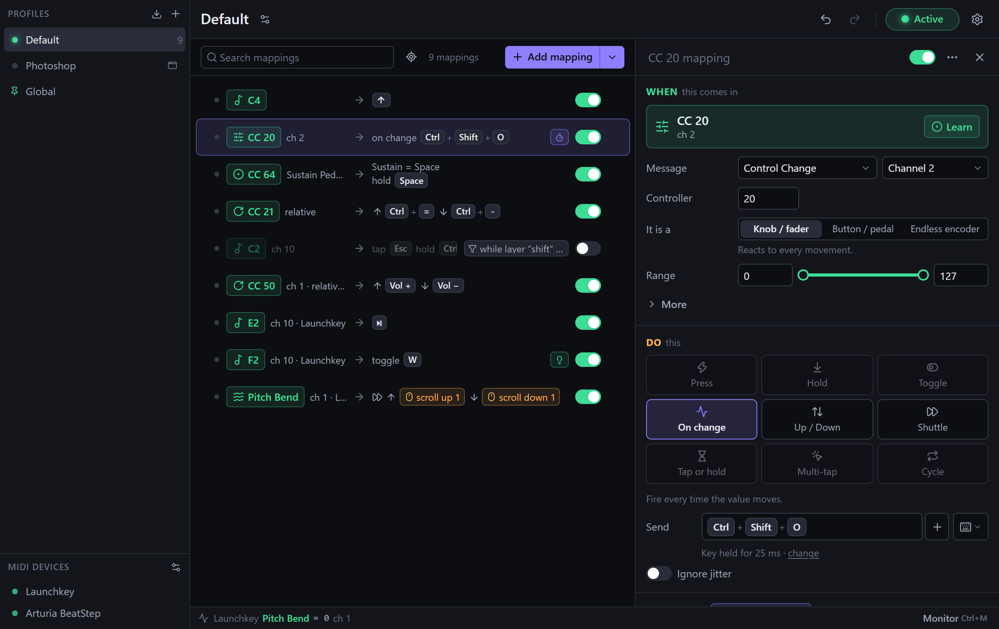

# MIDI 2 Keyboard

A fully featured, fully customizable application for translating MIDI events to keyboard events
(and mouse events, text, macros, …). Windows, macOS and Linux.

It is built around two promises:

- **The simple case is trivial.** Click **Add mapping**, press middle C on your controller, press
  the Up arrow on your keyboard. Done.
- **The weird case is possible.** *"CC 20 on channel 2 comes from a knob; when I turn it, send
  Ctrl+Shift+O — but at most once every 500 ms."* That is one mapping with a rate limit.



## What it can do

**Every kind of MIDI input**

| Source | Notes |
| --- | --- |
| Notes | single notes or ranges, any/one channel, velocity zones |
| Chords | several notes held together, optionally "struck within N ms" |
| Control Change | knobs/faders, buttons and pedals (a "pressed" range, including buttons that only ever send "on"), endless encoders in all three relative encodings (two's complement, binary offset, sign-magnitude) |
| 14-bit CC, NRPN, RPN | assembled from their MSB/LSB/data messages; 7-bit or 14-bit data; increment/decrement |
| Program Change, Pitch Bend, Channel and Poly Pressure | |
| SysEx | byte patterns with `??` (any byte) and `**` (any run) wildcards, MMC presets |
| Clock, Start/Stop/Continue, Song Select/Position, … | e.g. "every beat" or "every bar" of MIDI clock |

**MIDI learn that understands the control.** Touch something and the app works out whether it is a
key, a pad, a chord, a button, a pedal, an absolute knob, an endless encoder (and which encoding
it speaks, acceleration included), or an NRPN parameter.

**Behaviors** — how a control is interpreted:

- **Press** – fire once on press (and, optionally, on release); optional auto-fire while held
- **Hold** – keep keys down exactly as long as the control is held, with keyboard-like auto-repeat
- **Toggle** – first press holds, next press releases
- **On change** – fire whenever a knob/fader moves
- **Up / Down** – one action per step up, another per step down (absolute controls and encoders),
  optionally a second, coarser action for fast turns
- **Shuttle** – repeat an action for as long as the control is pushed away from where it rests,
  faster the further: a pitch wheel that scrolls, a shuttle ring, a joystick axis that moves the
  pointer, a fader that sets an auto-fire pace, a pad that fires faster the harder it is hit
- **Tap or hold** – different actions for a quick tap and a long press (including dual-role keys:
  tap = Esc, hold = Ctrl)
- **Multi-tap** – single / double / triple press, plus a long press, on one control
- **Cycle** – each press fires the next action in a list

**Actions** — key combinations, typed text (with `{value}`, `{note_name}`, … placeholders), mouse
clicks / scrolling / movement, macros with delays, profile switching, layers, pause/resume/panic,
launching programs, opening files and URLs, sending MIDI (to other gear, or as lights on the
controller: see [Sending MIDI and lights](#sending-midi-and-lights)).

**MIDI thru** — a device can be passed on, message for message, to another port, so that another
program (a DAW) hears it too while this app holds it.

**Shaping** — rate limits (throttle, throttle with a final trailing fire, debounce), conditions
(only in a certain application, only while a layer is on, only while another pad is held, only
while a knob is in a certain position), a dead zone for jittery pedals and faders, a jitter guard
for worn knobs that flutter on their own, debouncing for chattering switches, per-action timing.

**Organization** — profiles, always-on (global) profiles, automatic profile switching by
foreground application (picked from a list of open apps) or by program change, layers with
one-click "layer variants", mapping a whole run of notes to a row of keys in one step, splitting
a knob or fader into zones (a selector switch: one key per position) or a pad into velocity
bands (a soft and a hard hit press different keys), import/export, undo/redo, copy and paste of
mappings as plain text. The list points out mappings that share a control, and *find by
touching* jumps to the mapping of whatever control you touch.

**Feedback** — a live monitor of everything that comes in and everything that goes out (including
*why* something was not sent; a repeating shuttle shows as one row about every tenth of a second,
with ×N, rather than a row per firing), the engine's measured MIDI-to-key latency, an activity
dot on every mapping in the list, and an on-screen virtual controller for trying things without
hardware.

**Safety** — everything the app holds down is tracked and released on pause, profile switch,
device disconnect, config change and exit, and before the computer sleeps or the screen locks
(Windows, and Linux through logind); a key release the system refuses is retried until it goes
through. Should the app itself fail, it lets go of every key on the way out and says so at the
next start. (A macro that is already playing finishes across a profile switch, and releases
what it pressed at its end.) By default no keys or mouse input are sent while the app's own
window has focus (MIDI still is), so a mapping cannot type into (or close) the editor.

**Light on the machine** — the engine is native code on its own thread (tens of microseconds
from MIDI message to key event, 0% CPU when idle). Closing the window keeps the mappings running
from the tray with no browser view loaded at all (about 30 MB).

## Platform status

| | Builds and packages in CI | Verified on a real machine |
| --- | --- | --- |
| Windows 10/11 | yes (NSIS + MSI) | yes — end to end, real keystrokes |
| macOS 11+ (universal) | yes (DMG) | not yet — compiled and reviewed only |
| Linux (X11 / Wayland via uinput) | yes (deb, rpm, AppImage) | not yet — compiled and reviewed only |

Not there yet:

- Per-application profiles on Wayland (there is no portable way to ask which window is in front).
- Signed installers: Windows SmartScreen and macOS Gatekeeper warn about the downloads.

## Using it

1. Start the app. Connected MIDI devices are opened automatically (bottom left).
2. Click **Add mapping** (or press `N`), touch a control, press the key or shortcut to send.
3. Switch to the application you want to control and use your controller.

Everything else is under **All options** in the editor. The **Monitor** (bottom right, `Ctrl+M`)
shows what is going on, and its *Virtual controller* tab lets you play notes and turn knobs
without any hardware. Ready-made profiles (gaming, streaming, video editing, presenting, …) are
one click away: the import button at the top of the profile list, or *start from an example* in
an empty profile. The files are in [`examples/`](examples).

Keys are not sent while the app's own window is in front (so a mapping cannot type into the
editor) — switch to the application you want to control to try a mapping. If nothing happens,
look at the status bar at the bottom: it shows the last message that came in and, when nothing
was sent, why (no mapping, its mapping is switched off, only mapped in another profile, held
back by a rate limit, …). For a control that has no mapping yet, *map it* next to that
message starts one with the control already filled in.

To stop everything your mappings send, click **Active** at the top right (it turns into
**Paused**; MIDI thru keeps passing devices on), or press the
shortcut set under Settings → *Pause from anywhere*, which pauses and resumes from whichever
application is in front. It is Ctrl, Alt or Win plus one other key (F13–F24, Pause and Scroll
Lock also work alone); a combination that would get in the way of typing is refused, and the app
says so when another program already uses it. (On Wayland it works only while an X11 application
has focus.) If a key ever seems stuck, the *release* link next to "holding …" in the status bar
lets go of everything.

Closing the window keeps the app running in the tray (the first time, it says so). Click the
tray icon (on Linux: *Open* in its menu) or simply start the app again to get the window back,
where you left it: its size and position are kept, across restarts too.
The tray menu also pauses output, releases all keys, switches profiles and quits. To make
closing the window quit the app instead, turn off *Keep running when the window is closed* in
Settings; *Launch at login* is there too.

### Keyboard shortcuts

| Key | What it does |
| --- | --- |
| `N` | Add a mapping: touch a control, then press the key or shortcut to send |
| `Enter` | Open the focused mapping |
| `Esc` | Cancel a key capture; close the quick add, the editor, a menu or a dialog; let go of picked mappings |
| `↑` / `↓` | Previous / next mapping |
| `Alt+↑` / `Alt+↓` | Move the mapping up / down |
| `Ctrl`+click, `Shift`+click, `Shift+↑` / `↓`, `Ctrl+A` | Pick several mappings: enable, disable, duplicate, copy, move or delete them together |
| `Del` | Delete the focused mapping, or all picked ones (the message that follows has *Undo*) |
| `Ctrl+D` | Duplicate the focused mapping, or all picked ones |
| `Ctrl+C` / `Ctrl+V` | Copy the focused mapping (or the picked ones) / paste mappings into the profile in view. They travel as plain JSON text, so they can be pasted into a chat or a text editor and back |
| `Ctrl+Z` / `Ctrl+Shift+Z` | Undo / redo (`Ctrl+Y` redoes too) |
| `Ctrl+F` | Search mappings |
| `Ctrl+M` | Show / hide the monitor |
| `Ctrl+,` | Settings |
| `F2` | Rename the profile that has the focus in the sidebar |
| `Backspace` | Clear the shortcut field that has the focus |
| Right-click, `Shift+F10` | The menu of a mapping: edit, duplicate, disable, move up / down, move or copy to another profile, delete. On empty space: add a mapping, map a run of notes |

On a Mac, use `Cmd` instead of `Ctrl`; the ⌫ key deletes too. To send `Esc` itself, pick it from
the list (the button right of the shortcut field): pressing `Esc` there cancels the capture.

### Sending MIDI and lights

A mapping can send MIDI as well as keys. The **Send MIDI** action (also a macro step) sends a
note, a control change, a program change or raw bytes (SysEx), with a fixed value or the one that
came in: pass a control on to other gear, switch a synth's sound. And a mapping can **light its
pad** (*Light on the controller* in the editor, or one click in the quick add): one message when
a state turns on, another when it turns off — while the mapping is held or toggled on, while a
layer is on, or while a profile is active. Most pad controllers light a pad for a note on and
switch it off for velocity 0. [`examples/pad-lights.json`](examples/pad-lights.json) shows all
three.

- **Where it goes.** *The controller it came from* is the output named like the input the message
  came from (Windows' extra `MIDIIN2 (…)` ports pair with `MIDIOUT2 (…)`); any output can also be
  picked by name. A light on a mapping that listens to any device goes to the only connected
  controller that has an output; with several, to the one its control was last touched on.
- **Outputs are opened only when something is sent to them** (they are listed under *MIDI
  devices*). Windows' one-program-per-device rule applies to them too: while a DAW holds the
  controller's output, lights cannot reach it; the output says so and is retried. Switching a
  device off under *MIDI devices* also stops everything the app would send to it: its output
  stays closed, and lights and *Send MIDI* aimed at it say that it is switched off.
- Lights are sent when their state changes, and all of them again when the controller
  (re)connects. Pausing turns off the lights of what it releases (toggles and holds); layer and
  profile lights stay as they are. On exit nothing is sent: the lights keep their last state.

**Passing a controller on (MIDI thru).** On Windows a MIDI device serves one program at a time, so
while this app has the controller, a DAW cannot listen to it. Under *MIDI devices*, click *pass it
on…* next to the controller and pick the port to *pass everything it sends on to*: a virtual port
(create one in loopMIDI on Windows, or an IAC bus on macOS; on Linux programs can share a device
anyway). Point the other program at that port. Both then get every message, mapped or not, also
while output is paused (only bytes that are not a MIDI message, and a SysEx longer than 4096
bytes, stay behind; the app reports the latter once); what comes straight back from the virtual
port is recognized as an echo and not acted on twice. A target switched off under *MIDI
devices*, or `M2K_NO_MIDI_OUT`, stops it like any other MIDI the app sends. When the target is
missing, switched off or cannot be opened, the app says so once, not per message, and carries
on by itself when it is there again.

Good to know:

- **Windows:** most MIDI drivers allow only one program to open a device at a time. If your DAW has
  the controller open, this app cannot open it (and vice versa) — it will say so and keep retrying.
  To control windows that run as administrator, run this app as administrator too (Settings
  offers to restart it that way). A controller keeps its name, and with it its mappings, when
  you move it to another USB port.
- **macOS:** the app needs the *Accessibility* permission to send keys
  (System Settings → Privacy & Security → Accessibility). It asks on first use.
- **Linux:** on X11 it works out of the box. On Wayland it needs access to `/dev/uinput`: the deb
  and rpm packages install the udev rule for that; with the AppImage the app shows the rule to
  add. Per-application profiles need X11.

The configuration is a single JSON file, `config.json` in `%APPDATA%\midi-2-keyboard` (Windows),
`~/Library/Application Support/midi-2-keyboard` (macOS) or `~/.config/midi-2-keyboard` (Linux);
Settings → *Show config file* takes you there. It is saved atomically with a backup copy
(`config.backup.json`); a corrupt file is set aside and the backup restored. You can edit it by
hand while the app is running. To keep a separate setup (for example a portable one), set the
environment variable `M2K_CONFIG_DIR` to another folder before starting the app.

### Writing the config by hand

A hand-written file only needs what makes each mapping what it is; everything else has a
default (ids are assigned, velocities default to 1–127, a rate limit is a throttle, and so on).
Saved while the app runs, it is picked up within a couple of seconds; a mistake is reported with
its line and column, and the previous configuration stays active.

```json
{
  "profiles": [{
    "name": "My controller",
    "mappings": [
      { "source": { "event": { "type": "note", "notes": 60 } },
        "behavior": { "type": "hold", "target": { "type": "keys", "keys": ["ArrowUp"] } } },
      { "source": { "channel": 2, "event": { "type": "control_change", "controller": 20 } },
        "behavior": { "type": "change", "action": { "type": "keys", "keys": ["ControlLeft", "ShiftLeft", "KeyO"] } },
        "rate_limit": { "interval_ms": 500 } },
      { "source": { "event": { "type": "control_change", "controller": 64 } },
        "behavior": { "type": "trigger", "on_press": { "type": "keys", "keys": ["Space"] } } }
    ]
  }]
}
```

Shorthands:

- A range can be a single number (`"notes": 60`), or leave out an end: `{"min": 64}` is 64 and
  up, `{"max": 63}` up to 63.
- A knob, fader, pedal or pitch bend written without `range` gets the one its behavior needs:
  the whole range for `change` and `step` (they follow the value), the "pressed" upper half for
  everything that presses and releases (`trigger`, `hold`, `toggle`, ...). For pitch bend that
  half starts above the resting center.
- Keys are named like the browser's `KeyboardEvent.code`: `KeyA`, `Digit1`, `ArrowUp`, `Space`,
  `ControlLeft`, `ShiftLeft`, `F13`, `NumpadAdd`, `AudioVolumeUp`.
- MIDI thru is a setting of the device: `"devices": [{"name": "…", "forward_to": "…"}]`, with the
  names of an input and of an output as the app lists them.
- A shuttle needs only its actions: `{"type": "shuttle", "up": …, "down": …}`. It rests in the
  middle for pitch bend and at the bottom for everything else (`"rest": "center" | "low" |
  "high"`), the 5 % next to that still count as rest (`dead_zone`), and it fires every 400 ms
  just outside that and every 30 ms at the end of the travel (`slow_ms`, `fast_ms`), in between
  at a rate that grows evenly with the distance; `"curve": "squared"` keeps it gentle near rest.
- Leaving out `version`, `id`, `name`, `velocity`, a tap-hold's `hold_ms` or a multi-tap's
  `window_ms` is fine; the full format is what the app writes back when you change anything in
  it.

## When something does not work

- **Nothing is typed.** The status bar at the bottom says why for the last message: *this window
  is in front* (no keys are sent while the app has focus: switch to the target app), *output is
  paused* (click **Paused**), *its mapping is switched off*, *only mapped in "…"* (another profile
  is live), *outside the range its mapping reacts to*, *held back by the rate limit*, *condition
  not met*, or *no mapping*. The **Monitor** (`Ctrl+M`) shows the same for every message. macOS,
  and Linux on Wayland, need a permission first (see *Good to know* under [Using it](#using-it)).
- **A controller is not listed, or "could not be opened".** On Windows most MIDI drivers serve one
  program at a time: close the other one (a DAW, another MIDI tool) and the port opens by itself.
  A device switched off under *MIDI devices* (the button next to MIDI DEVICES) stays closed; so do
  new ones while *Connect new MIDI devices automatically* is off in Settings. *Rescan now* there
  looks for devices again. To use a controller here and in another program at the same time,
  pass it on to a virtual port ([MIDI thru](#sending-midi-and-lights)).
- **Up / Down stops at the end of a knob.** A knob with end stops, or an endless encoder left in
  its absolute mode, sends nothing more at 0 and at the top. Set the encoder to a relative mode on
  the controller, then choose *Endless encoder* in the editor (it warns when a control gets there).
- **Turning a knob fires far too often.** A turn sends dozens of messages. Take the editor's offer
  *Limit to once per 500 ms* (or set any *Rate limit*), or use *Up / Down* with a larger step.
- **Keys do not reach a game, or a program run as administrator.** Windows keeps input from
  ordinary programs out of programs that run as administrator; the app says so and offers
  *Restart as administrator* (also in Settings). Some games ignore very short taps: set *Key tap
  length* in Settings to 40–60 ms.
- **A key seems stuck.** Click *release* next to "holding …" in the status bar, or *Release all
  keys* in the tray menu; pausing releases everything too. If the app fails, it releases what it
  holds on the way out and says so at the next start (details in `crash.log` next to the config
  file). If it was killed outright, press and release that key on the keyboard.
- **The controller is silent after the computer slept.** On Windows, and on Linux through
  logind, the app releases what it holds before sleep and lock, and reopens its MIDI devices after
  waking and unlocking (on Windows also after switching back to your user). On macOS, or if it
  stays silent: *Rescan now* under *MIDI devices*.
- **Lights or *Send MIDI* do nothing.** They go to the output named like the controller's input
  (see [Sending MIDI and lights](#sending-midi-and-lights)): check that the controller is listed
  under OUTPUTS in *MIDI devices*, that it is not switched off there, and that no other program
  holds that output. With the environment variable `M2K_NO_MIDI_OUT` set, nothing is ever sent
  (the monitor says "MIDI output is switched off").
- **The configuration did not load.** A `config.json` that cannot be read is kept as
  `config.corrupt-<number>.json`, and the backup next to it (`config.backup.json`) or a default is
  used; the app says which. A mistake in a file edited by hand while the app runs is reported with
  its line and column, and the previous configuration stays. Where the file lives: see
  [Using it](#using-it).

## Building from source

Prerequisites: [Rust](https://rustup.rs) (stable) and Node.js 20+.

- **Windows:** the MSVC toolchain (Visual Studio Build Tools, "Desktop development with C++"), or
  the GNU toolchain with MinGW-w64 on `PATH` (`windres` and `dlltool` are needed).
- **macOS:** Xcode command line tools.
- **Linux (Debian/Ubuntu):** `sudo apt install build-essential pkg-config libssl-dev libasound2-dev
  libwebkit2gtk-4.1-dev libayatana-appindicator3-dev librsvg2-dev libxdo-dev`

```sh
npm install
npm run tauri dev        # run the desktop app in development mode
npm run tauri build      # build a release bundle into target/release/bundle
```

Other useful commands:

```sh
npm run dev                                   # the UI alone in a browser, against a mock backend
npm run bindings                              # regenerate the TypeScript types from the Rust types

# m2k, the headless companion (npm run cargo -- run -p m2k-cli -- <command>)
m2k devices                                   # list MIDI input ports
m2k monitor [name]                            # print incoming MIDI, decoded
m2k outputs                                   # list MIDI output ports (opens none of them)
m2k send <port> <hex bytes>...                # send MIDI to an output once, e.g. B0 07 64
m2k run [--config file] [--dry-run]           # run a config without the UI (dry run sends nothing)
m2k simulate config.json script.txt           # replay scripted MIDI and print what would be sent
```

## How it is put together

```
crates/m2k-midi     MIDI parsing, state tracking (NRPN/RPN/14-bit), device input/output, hot-plug
crates/m2k-output   key model and OS input injection (SendInput / CGEvent / uinput / XTest)
crates/m2k-core     config model, persistence, the engine, the application runtime
crates/m2k-cli      headless tools (devices, monitor, outputs, send, run, simulate)
src-tauri           the desktop shell (Tauri v2): commands, tray, autostart, single instance
src                 the UI (React + TypeScript)
```

The engine runs on its own thread with a timer queue and never touches the UI thread: a MIDI
message goes from the OS callback through a channel into the engine and out through the OS input
API. The UI only ever sees batched copies of what happened.

Contributor notes for people and agents are in [AGENTS.md](AGENTS.md).
